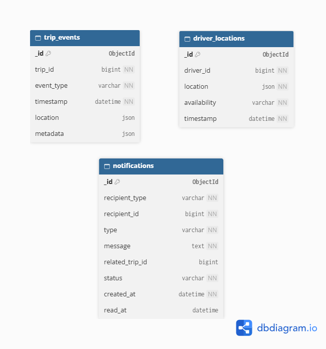
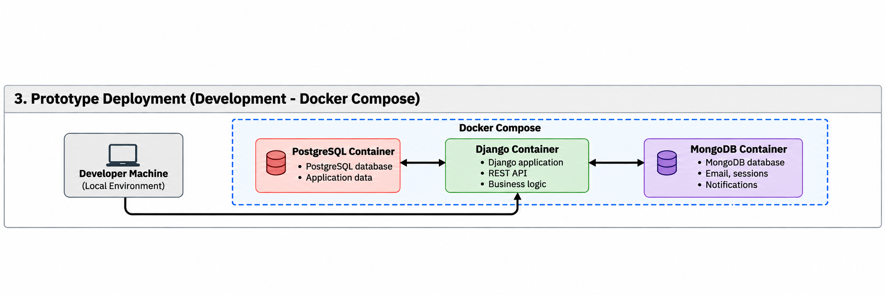

# Ride-Hailing Platform (TVDE)

## Iteration 1 Report: Specification and Planning

# 1. Project Description and Requirements

## 1.1 Application Domain
This system is Ride-Hailing Platform which is designed for transportation of individual passenger, and it is based on the operational model of TVDE (Transport in an Uncharacterized Vehicle from an Electronic Platform) services.
The platform creates digital environment, which allows to connect passengers, who need transportation services, with drivers and their vehicles.

Passengers may request the trips with the specified pickup point and destination, while drivers may accept such requests.
The trip is going through its life cycle which includes request and assignment of a driver, passenger pickup, execution of the trip, its end and payment. Within this process, the platform should deal with transactional information and information generated continuously during the service.

Therefore, this system contains both stable information with high structure (passenger accounts, drivers, vehicles, trips and payments) and dynamic information (availability of drivers, geolocation of passengers, events generated during the trip).
The application will be developed with Django framework as a main application framework. Polyglot persistence approach will be used in order to develop the database architecture. It means that various database technologies may be used depending on the type of the data.

## 1.2 Motivation
A ride-hailing service is a pertinent case study with respect to the administration of databases because it involves the concomitant management of transactional, spatial and high frequency data.

The core processes of business operations, which include user registration, vehicle registration, creation of trips, allocation of drivers, payment registration and rating submissions, entail consistency and data integrity. However, at the same time, the system should process volatile data including the availability and location of drivers and events during the course of a trip.
The coexistence of these different aspects of the data make it a particularly appropriate setting to examine a polyglot persistence architecture that uses relational and non-relational databases as per the needs.

The system also allows one to examine the issue of indexing, concurrent access, transactions, scalability, database growth, backups and recovery, availability and scaling.

For all these reasons, the domain of ride-hailing services offers enough complexity to examine database design and administration issues without being too complex for implementation in a prototype.

## 1.3 System Scope
The project concentrates on database and backend systems which are necessary to implement the primary life cycle for ride hailing system.

The prototype will cover:
- passenger management;
- driver management;
- vehicle management;
- driver availability;
- trip requests;
- driver assignment;
- trip lifecycle management;
- driver location information;
- payments;
- passenger and driver ratings;
- notifications;
- trip history;
- administrative operations.

Real payment gateway interface, route optimization, dynamic pricing algorithm, identity verification services, mobile applications and maps provided by third-party applications do not belong to the first iteration of the prototype.
If required, they can be implemented in simulated form to have corresponding database operations performed and tested.

## 1.4 Main Actors
### Passenger
The passenger can:

- manage their account and profile;
- request a trip;
- define pickup and destination locations;
- cancel a trip when permitted;
- follow the current state of a trip;
- consult previous trips;
- consult payment information;
- rate a driver after a completed trip;
- receive notifications related to the requested service.

### Driver
The driver can:

- manage their profile;
- associate or use an authorized vehicle;
- change their availability status;
- update their current location;
- receive trip requests;
- accept or reject eligible requests;
- update the state of an assigned trip;
- consult completed trips;
- rate passengers;
- receive operational notifications.

### Administrator
The administrator can:

- manage passenger and driver accounts;
- manage registered vehicles;
- activate or suspend accounts when required;
- inspect trips and their current states;
- inspect payment records;
- access operational information required for platform management;
- investigate inconsistent or failed operations.

### Support Operator
The operator can:

- search for users and trips;
- inspect the lifecycle and relevant events of a trip;
- inspect payment status;
- consult relevant operational records;
- register or follow incidents associated with a trip.

## 1.5 Use Cases
| ID | Actor | Use Case |
|---|---|---|
| UC01 | Passenger | Register account |
| UC02 | Passenger | Manage profile |
| UC03 | Passenger | Request trip |
| UC04 | Passenger | Cancel trip |
| UC05 | Passenger | View trip status |
| UC06 | Passenger | View trip history |
| UC07 | Passenger | Rate driver |
| UC08 | Driver | Manage profile |
| UC09 | Driver | Manage availability |
| UC10 | Driver | Update current location |
| UC11 | Driver | Receive trip request |
| UC12 | Driver | Accept/reject trip |
| UC13 | Driver | Start trip |
| UC14 | Driver | Complete trip |
| UC15 | Driver | Rate passenger |
| UC16 | System | Register payment |
| UC17 | System | Generate notification |
| UC18 | Administrator | Manage users |
| UC19 | Administrator | Manage vehicles |
| UC20 | Administrator | Inspect trips/payments |
| UC21 | Support Operator | Investigate trip incident |

The core use case in this system is **Request Trip (UC03)**. The passenger inputs his/her pick-up location and destination, and a new trip request gets created. The system finds a suitable available driver and puts him/her in a position to accept the request.

When a driver accepts the request (UC12), the trip gets assigned to that particular driver and his/her current car. The trip will move through all its states till it gets either completed or cancelled.

During the course of the trip, many operational events and location data may be created at frequent intervals. When the trip gets completed, all the details of that particular trip get saved in the system and its related payment process is also noted. The passengers and drivers may rate the completed trips.

### Trip Lifecycle

A trip is expected to progress through a controlled set of states:

`REQUESTED → DRIVER_ASSIGNED → DRIVER_ARRIVING → IN_PROGRESS → COMPLETED`

A trip may transition to `CANCELLED` from an eligible state according to the business rules of the platform.

The trip state is considered critical business data. Invalid state transitions must therefore be prevented by the application and, whenever appropriate, reinforced through database constraints or transactional operations.

## 1.6 Functional Requirements

| ID | Requirement |
|---|---|
| FR01 | The system shall allow passengers to create and manage an account. |
| FR02 | The system shall allow drivers to maintain a driver profile. |
| FR03 | The system shall maintain information about vehicles authorized for use on the platform. |
| FR04 | The system shall allow drivers to change their availability status. |
| FR05 | The system shall receive and maintain the current location of available/active drivers. |
| FR06 | The system shall allow passengers to request a trip by specifying pickup and destination locations. |
| FR07 | The system shall associate a trip request with an eligible driver. |
| FR08 | The system shall allow a driver to accept or reject a trip request. |
| FR09 | The system shall maintain the lifecycle and current status of each trip. |
| FR10 | The system shall allow eligible trips to be cancelled. |
| FR11 | The system shall record the final price and payment information associated with a completed trip. |
| FR12 | The system shall allow passengers to consult their trip history. |
| FR13 | The system shall allow drivers to consult their trip history. |
| FR14 | The system shall allow passengers and drivers to rate each other after a completed trip. |
| FR15 | The system shall generate and store relevant notifications. |
| FR16 | The system shall record relevant operational events generated during a trip. |
| FR17 | Administrators shall be able to manage users, drivers and vehicles. |
| FR18 | Authorized administrative/support users shall be able to search and inspect trips and their associated operational information. |

## 1.7 Data Requirements
The platform must manage data with different consistency, persistence, access and scalability characteristics.

### Core Transactional Data
The system must persist structured information concerning:
- passengers;
- drivers;
- vehicles;
- driver–vehicle associations;
- trips;
- trip participants;
- trip status;
- pickup and destination information;
- trip timestamps;
- prices;
- payments;
- ratings.

This information represents the core business state of the platform.
Relationships between these records must remain consistent and the system must preserve referential integrity.

### Operational Data
The platform needs to handle operation data that will be produced at a much higher rate than the majority of transactional business information.

This includes:

- driver location updates;
- driver availability information;
- trip lifecycle events;
- notification data;
- operational metadata associated with active trips.

This data can be created frequently and may not necessarily need the same relational model that transactional information does.

### Identifiers
Every single business organization has to have unique identifier numbers. The identifier should be able to remain constant regardless of changing parameters like name, email, and car license plate.

The connection between two transactional entities has to be captured using unique identifiers.

## 1.8 Typical Database Operations
| Operation | Type | Frequency | Criticality |
|---|---|---:|---|
| Authenticate user | Read | High | High |
| Retrieve passenger profile | Read | Medium | Medium |
| Retrieve driver profile | Read | Medium | Medium |
| Update driver availability | Write | High | High |
| Update driver location | Write | Very High | High |
| Find available drivers | Read | Very High | High |
| Create trip request | Write | High | Critical |
| Assign driver to trip | Read/Write | High | Critical |
| Update trip status | Write | High | Critical |
| Retrieve active trip | Read | Very High | Critical |
| Complete trip | Transaction | High | Critical |
| Register payment | Transaction | Medium/High | Critical |
| Retrieve trip history | Read | Medium | Medium |
| Create rating | Write | Medium | Low/Medium |
| Generate notification | Write | High | Medium |
| Retrieve notifications | Read | High | Medium |
| Store trip event | Write | Very High | Medium |
| Administrative reporting | Read/Aggregation | Low | Low/Medium |

The expected operations are shown to have two very distinct load profiles.

Transaction operations have fewer writes than location or event information but need strong consistency assurances. Creating a trip, associating a driver with it, concluding a trip and recording payment for the same are some examples of operations which would cause changes in the business state of the platform through partial or inconsistent update of information.

Operations will consist of many more writes. In particular, active drivers can send location information again and again whereas active trips can send operational events continuously.

Read load is also expected to be important. Active trips and available drivers need to be fetched frequently. Current trip information and historical information needs to be made available frequently to users.

## 1.9 Expected Workloads

### Normal Operation
For the platform to work under standard circumstances, it should consist of many more registered users than simultaneous users.

The database is made up of profile reading, trip request, active trip update, location update and notification queries.

### High Demand
In times when there is high demand for transportation, the number of passengers making requests and drivers posting their location may significantly grow.

This produces simultaneous growth in:

- trip creation operations;
- searches for available drivers;
- driver assignment operations;
- location writes;
- active trip reads;
- trip event writes;
- notifications.

The database design should be prepared to account for the non-constant load and allow scaling of the parts of the system affected by it.

## 1.10 Initial Data Classification - SQL vs NoSQL
| Data | Initial classification | Main reason |
|---|---|---|
| Passenger | Relational | Structured/core business data |
| Driver | Relational | Structured/core business data |
| Vehicle | Relational | Integrity and relationships |
| Trip | Relational | Transactional consistency |
| Payment | Relational | Transactional consistency |
| Rating | Relational | Relationship with completed trip |
| Driver location | NoSQL candidate | Frequent updates/geospatial data |
| Trip events | NoSQL candidate | High write volume/flexible event structure |
| Notifications | NoSQL candidate | Flexible operational data |

# 2. Selection of Database Technologies

## 2.1 Database Requirements Derived from the Application
The requirements and workloads established for the Ride-Hailing Platform indicate the presence of two distinct groups of data having different properties with regard to persistence and access.

The first group is made up of business data associated with the functionality of the platform including data about passengers, drivers, vehicles, rides, payments and ratings. These objects have clearly defined relationships and demand data integrity, consistency and transactions.
The operations performed on this data must not result in an incomplete or inconsistent database state.

The other group of data includes the operational data being created as the system is running. The driver locations and ride events can be created very often and the structure can change as new event types and operational data become necessary. This kind of workloads is likely to demand write frequencies that far exceed the write frequencies typical of most business data.

This is why the project is using a polyglot persistence approach as opposed to forcing everything into one single storage approach. A relational DBMS will handle the transactional core of the application and a non-relational DBMS will handle some operational data.

## 2.2 Relational DBMS — PostgreSQL
PostgreSQL was selected as the relational DBMS responsible for the
transactional core of the Ride-Hailing Platform.

### 2.2.1 Role in the System
PostgreSQL will primarily manage structured business entities and their
relationships, including:

- passengers;
- drivers;
- vehicles;
- driver–vehicle associations;
- trips;
- payments;
- ratings;
- administrative business data.

These entities represent the authoritative business state of the platform
and require strong integrity guarantees.

### 2.2.2 Justification
PostgreSQL was chosen due to the relational structure of the basic data stored on the platform. A trip, for example, relates to the passenger, to the driver and the vehicle and might later relate to the payment and ratings. Keeping the relations intact is the core requirement of the system.

The relational structure helps maintain these relations via primary keys, foreign keys, unique and other integrity constraints.

The transactional support is especially critical when dealing with operations that affect multiple records related to each other. For example, accepting the trip request requires the system to check the current status of the trip, choose the driver and vehicle and update the status of the trip as one consistent operation.

In the same manner, the trip completion and recording the result data cannot leave the system in the inconsistent state even in case of failed operation.

PostgreSQL offers SQL functionality necessary to deal with the expected queries on the structured data, including joins, filters, aggregation and history queries. The examples can be fetching all the completed trips of the passenger, listing all the trips done by the driver within some period or analysing payments data.

These characteristics make a relational DBMS appropriate as the authoritative data store for the transactional component of the platform.

#### A concrete example: accepting a trip

Suppose:
Trip #451
status = REQUESTED

Driver A and Driver B receive the request at approximately the same time.
Both press Accept.

We cannot end up with:
Trip 451
Driver A -> ACCEPTED
Driver B -> ACCEPTED

A representative consistency requirement occurs when multiple drivers attempt to accept the same trip request. The platform must guarantee that a trip is not simultaneously assigned to multiple drivers. The operation therefore requires appropriate transactional and concurrency-control mechanisms.

This type of operation reinforces the decision to maintain trip assignment and the corresponding business state in the relational database.

### 2.2.3 Integration with Django
In implementing the application backend, we will use Django framework.
Consequently, the relational domain model will be modeled using Django models and migrations whereas PostgreSQL will take care of persistence and database integrity.

The ORM (Object-Relational Mapping) provided by Django framework will help us handle typical application level operations over the relational data model. Nevertheless, the management of the following database administration tasks will be done explicitly: indexes, constraints, users, privileges, backup and recovery, as well as performance analysis.

## 2.3 Non-Relational DBMS - MongoDB
MongoDB was selected as the non-relational DBMS for selected operational data generated by the platform.

### 2.3.1 Role in the System
The initial MongoDB scope includes:

- driver location updates;
- trip events;
- selected operational metadata;
- potentially notifications whose structure and lifecycle are independent from the transactional core.

MongoDB will not replace PostgreSQL as the authoritative source for core business entities such as trips or payments.

### 2.3.2 Justification
MongoDB was chosen because some of the data in the Ride-Hailing Platform is operational data which does not need to be structured in the same way as the transactional business data.

Driver location data are recorded repeatedly as long as the driver remains active. In the same way, multiple events are produced during the life cycle of a trip, and these events can be different types containing different metadata.

The document data model makes it possible for each of these documents to contain specific details about the operation without all the potential events having to be structured identically in a table.

For example, a driver-location document could contain the driver id, the geographic coordinates, availability details and a time stamp, and the trip-event document could contain the trip id, the event type, a time stamp and event-specific details.

This also allows high volume operation write operations to be separated from the relational workload which deals with trips, payments and other vital business data.

MongoDB complements PostgreSQL but does not replace it: each database technology is given the data and workload suitable to their model.

### 2.3.3 Data Ownership
The implementation of several databases creates the opportunity for the duplication of data across databases. In order to eliminate inconsistencies, there will be an official source for every category of business data.

PostgreSQL will be the official source for passengers, drivers, vehicles, trips, payments and ratings.

MongoDB data can include identifiers of these objects like `driver_id` and `trip_id`, but should not duplicate the mutable business data.

In case duplication will be done in future iterations for performance purposes, it must be clearly described.

## 2.4 Polyglot Persistence Strategy
This leads to an architecture that takes up the polyglot persistence strategy, whereby PostgreSQL and MongoDB each take a different role.

While PostgreSQL maintains the authoritative transactional state for the application, MongoDB maintains certain operational data, which is different from relational data.

The initial responsibility boundary is:

| Information | DBMS | Main Reason |
|---|---|---|
| Passengers | PostgreSQL | Structured business data |
| Drivers | PostgreSQL | Integrity and relationships |
| Vehicles | PostgreSQL | Integrity and relationships |
| Driver–Vehicle association | PostgreSQL | Referential integrity |
| Trips | PostgreSQL | Transactional consistency |
| Payments | PostgreSQL | Transactional consistency |
| Ratings | PostgreSQL | Relationship with completed trips |
| Driver location data | MongoDB | Frequent operational updates and geospatial data |
| Trip events | MongoDB | Event-oriented and potentially heterogeneous documents |
| Operational metadata | MongoDB | Flexible document structure |

The segregation is made considering the attributes of data and workload instead of merely splitting up the tables into multiple databases.

## 2.5 Alternatives Considered

### 2.5.1 MySQL
An alternative relational DBMS that was considered was MySQL. This is a mature relational DBMS that supports transactions, integrity constraints, indexing, and framework applications. Therefore, MySQL would have been able to provide all the necessary relational services of the proposed platform.

PostgreSQL was chosen for this project since the team plans to utilize the excellent relational services and other services within the database that will work perfectly well with the data model intended to be used in this project.

This choice of database management system does not mean that MySQL could not be suitable for this project; on the contrary, PostgreSQL was found suitable for the architecture designed by the team.

### 2.5.2 Redis
Redis was taken into consideration for fast temporary data such as authentication sessions, caching or temporary information about
the availability of drivers for some other short-lived application state.

Due to its key-value and in-memory structure along with expiration functions, Redis seems to be more suitable for data which
needs to be accessed very quickly and doesn’t have to be persistent.

The project team has opted not to use Redis among the major databases for the initial architectural design, since PostgreSQL and
MongoDB meet all the mandatory conditions of relational and non-relational databases accordingly, leaving the development scope
manageable.

Redis can be considered as a further step if there is a need for it proven by the testing process.

### 2.5.3 Neo4j
Graph databases have been considered since they are well suited for domains where the access pattern involves more of relationships and traversal of graphs.

The use of a graph database could be justified for advanced routing analysis and/or road network relationships. But the calculation of routes and full road network modeling are not within the scope of the prototype at this point in time.

The key relationships of passengers, drivers, vehicles, trips, and payments are well captured using the relational model, but location and event data are better captured using the document model chosen.

It is for the above reasons that using a graph DBMS would involve unnecessary complexity in deployment and administration at the present.
Neo4j has thus not been considered.

## 2.6 Technology Selection Summary
Based on the requirements that have been determined for the Ride-Hailing Platform, the team decided to use PostgreSQL and MongoDB as the main databases.

PostgreSQL will provide the transactional part of the system and will hold the official state of passengers, drivers, vehicles, trips, payments and ratings.

MongoDB will provide an additional database to store selected operational information starting with driver location changes and trip events.

This will enable each database to handle a workload that matches its data model without fragmenting the core information of the application in an unnecessary manner.

MySQL was also considered as an alternative relational DBMS, while Redis and Neo4j were also considered for selected non-relational workloads.
These solutions are technically relevant, yet not necessarily required.

The architecture chosen for Iteration 1 is thus:

- **Application framework:** Django
- **Relational DBMS:** PostgreSQL
- **Non-relational DBMS:** MongoDB

# 3. Database Models Specification

## 3.1 Data Distribution Overview
Ride-Hailing Platform makes use of the polyglot persistence approach in the implementation of its data storage layer which consists of PostgreSQL and MongoDB. Each of these DBMSs manages different data depending on its consistency needs and workload.
 
PostgreSQL handles the authoritative transactional state of the platform.
It handles structured business entities with complex relationships.

MongoDB manages selected operational data created by the platform as it executes its tasks. These can be created at high frequencies and can have variable structures depending on the operational events.

The initial distribution is the following:

| Data | Database | Model |
|---|---|---|
| Passenger | PostgreSQL | Relational |
| Driver | PostgreSQL | Relational |
| Vehicle | PostgreSQL | Relational |
| Driver–Vehicle association | PostgreSQL | Relational |
| Trip | PostgreSQL | Relational |
| Payment | PostgreSQL | Relational |
| Rating | PostgreSQL | Relational |
| Driver location | MongoDB | Document |
| Trip events | MongoDB | Document |
| Notifications | MongoDB | Document |

PostgreSQL is deemed as the source of truth in regards to the business status of a trip. Although MongoDB can make use of PostgreSQL objects using their IDs, the operational document does not take precedence over the relational business document.

## 3.2 PostgreSQL Relational Model

The following diagram presents the initial relational model for the transactional component of the Ride-Hailing Platform.


The diagram represents the main entities, identifiers, relationships and cardinalities of the PostgreSQL model.

### 3.2.1 Conceptual Model

We propose these seven relational entities:

Passenger
Driver
Vehicle
DriverVehicle
Trip
Payment
Rating

The conceptual relationships are:

```text
Passenger ───────────────< Trip >────────────── Driver
                             │                    │
                             │                    │
                             │                 DriverVehicle
                             │                    │
                             │                  Vehicle
                             │
                             ├──────── Payment
                             │
                             └────────< Rating

```


#### 3.2.1.1 Proposed ER relationships

```text
PASSENGER 1 ───────── N TRIP

DRIVER    1 ───────── N TRIP

DRIVER    1 ───────── N DRIVER_VEHICLE
                           N
                           │
                           1
                        VEHICLE

VEHICLE   1 ───────── N TRIP

TRIP      1 ─────── 0..1 PAYMENT

TRIP      1 ─────── 0..2 RATING
```


### 3.2.2 Passenger

The `Passenger` entity represents a customer who can request trips through the platform.

| Attribute | Description |
|---|---|
| passenger_id | Unique passenger identifier |
| first_name | Passenger's first name |
| last_name | Passenger's last name |
| email | Unique email address |
| phone_number | Unique contact number |
| status | Current account status |
| created_at | Account creation timestamp |
| updated_at | Timestamp of the last relevant account update |

`passenger_id` is the primary key.

Both `email` and `phone_number` must be unique.

The `status` attribute represents the operational state of the passenger account and will be restricted to values defined by the application, such as `ACTIVE`, `SUSPENDED` or `INACTIVE`.

### 3.2.3 Driver

The `Driver` entity represents a driver registered and authorized to perform trips through the platform.

Its main attributes are:

| Attribute | Description |
|---|---|
| driver_id | Unique driver identifier |
| first_name | Driver's first name |
| last_name | Driver's last name |
| email | Unique email address |
| phone_number | Unique contact number |
| license_number | Unique driving licence identifier |
| license_expiry_date | Expiration date of the driving licence |
| status | Driver account/authorization status |
| created_at | Creation timestamp |
| updated_at | Last update timestamp |

`driver_id` is the primary key.

The driver's licence number, email address and phone number must be unique.

### 3.2.4 Vehicle

The `Vehicle` entity stores information about vehicles authorized for use on the platform.

| Attribute | Description |
|---|---|
| vehicle_id | Unique vehicle identifier |
| registration_number | Unique vehicle registration number |
| make | Vehicle manufacturer |
| model | Vehicle model |
| manufacture_year | Year of manufacture |
| capacity | Maximum passenger capacity |
| status | Operational/authorization status |
| created_at | Registration timestamp |

The registration number must uniquely identify a vehicle.

The vehicle capacity must be greater than zero.

### 3.2.5 DriverVehicle

The relationship between drivers and vehicles is modelled through the `DriverVehicle` associative entity.

A driver may be authorized to use different vehicles over time, while a vehicle may also be associated with different drivers.

| Attribute | Description |
|---|---|
| driver_vehicle_id | Unique association identifier |
| driver_id | Driver reference |
| vehicle_id | Vehicle reference |
| valid_from | Beginning of the association |
| valid_until | End of the association, if applicable |
| active | Indicates whether the association is currently active |

`driver_id` is a foreign key referencing `Driver`.

`vehicle_id` is a foreign key referencing `Vehicle`.

### 3.2.6 Trip

`Trip` is the central transactional entity of the platform. It represents a transportation request from its creation until completion or cancellation.

| Attribute | Description |
|---|---|
| trip_id | Unique trip identifier |
| passenger_id | Passenger requesting the trip |
| driver_id | Assigned driver, if one has been assigned |
| vehicle_id | Vehicle used for the trip |
| pickup_latitude | Pickup latitude |
| pickup_longitude | Pickup longitude |
| destination_latitude | Destination latitude |
| destination_longitude | Destination longitude |
| requested_at | Time at which the trip was requested |
| accepted_at | Time at which a driver accepted the trip |
| started_at | Actual trip start |
| completed_at | Actual trip completion |
| cancelled_at | Cancellation timestamp |
| status | Current authoritative trip state |
| estimated_price | Price estimated when requesting the trip |
| final_price | Final amount after completion |

`trip_id` is the primary key.

`passenger_id` is a mandatory foreign key referencing `Passenger`.

`driver_id` and `vehicle_id` may initially be null because a trip exists before a driver accepts it. Once the trip reaches a state requiring an assigned driver, the application and database transaction logic must maintain a valid driver/vehicle assignment.

The initial set of allowed trip states is:

- `REQUESTED`
- `DRIVER_ASSIGNED`
- `DRIVER_ARRIVING`
- `IN_PROGRESS`
- `COMPLETED`
- `CANCELLED`

Only valid transitions between these states should be permitted.

### 3.2.7 Payment

The `Payment` entity represents the payment record associated with a trip.

| Attribute | Description |
|---|---|
| payment_id | Unique payment identifier |
| trip_id | Associated trip |
| amount | Amount to be paid |
| method | Payment method category |
| status | Current payment state |
| provider_reference | External/simulated payment reference |
| created_at | Payment creation timestamp |
| paid_at | Timestamp of successful payment |

Each payment belongs to exactly one trip.

For the initial prototype, each trip may have at most one payment record.
Therefore, `trip_id` must be unique in the `Payment` table.

Sensitive payment-card information will not be stored by the platform.

### 3.2.8 Rating

A `Rating` represents feedback submitted after a trip.

| Attribute | Description |
|---|---|
| rating_id | Unique rating identifier |
| trip_id | Trip being evaluated |
| rater_type | Indicates whether the author is the passenger or driver |
| score | Numerical rating |
| comment | Optional textual feedback |
| created_at | Rating creation timestamp |

A rating can only be associated with a completed trip.

The initial score range is from 1 to 5.

For each trip, a passenger may submit at most one driver rating and a driver may submit at most one passenger rating. This can be represented through a unique constraint over `(trip_id, rater_type)`.

### 3.2.9 Relationships

| Entity A | Cardinality | Entity B | Meaning |
|---|---:|---|---|
| Passenger | 1:N | Trip | Passenger may request multiple trips |
| Driver | 1:N | Trip | Driver may perform multiple trips |
| Vehicle | 1:N | Trip | Vehicle may be used in multiple trips |
| Driver | N:M | Vehicle | Implemented through DriverVehicle |
| Trip | 1:0..1 | Payment | Trip may have one payment |
| Trip | 1:0..2 | Rating | Passenger and driver may each rate the other |

These relationships are based on the life cycle of the service, rather than the current state of affairs. `DriverVehicle`, for instance, ensures that the relationship between drivers and vehicles is maintained, rather than holding just one permanent vehicle in `Driver`.

### 3.2.10 Integrity Constraints

**Entity integrity**

Every entity has a primary key.

**Referential integrity**

Trip.passenger_id → Passenger.passenger_id
Trip.driver_id → Driver.driver_id
Trip.vehicle_id → Vehicle.vehicle_id

DriverVehicle.driver_id → Driver.driver_id
DriverVehicle.vehicle_id → Vehicle.vehicle_id

Payment.trip_id → Trip.trip_id
Rating.trip_id → Trip.trip_id

**Uniqueness**

Passenger.email UNIQUE
Passenger.phone_number UNIQUE

Driver.email UNIQUE
Driver.phone_number UNIQUE
Driver.license_number UNIQUE

Vehicle.registration_number UNIQUE

Payment.trip_id UNIQUE

Rating(trip_id, rater_type) UNIQUE

**Domain constraints**

Vehicle.capacity > 0

Rating.score BETWEEN 1 AND 5

Trip.estimated_price >= 0
Trip.final_price >= 0

Payment.amount > 0

**Geographic constraints**

At minimum:
-90 <= latitude <= 90
-180 <= longitude <= 180

**Temporal constraints**

For a completed trip we expect logically:
requested_at
    <= accepted_at
    <= started_at
    <= completed_at

## 3.3 MongoDB Document Model

The following diagram provides a conceptual representation of the main MongoDB collections.



The diagram is intended to represent the structure of the MongoDB documents rather than a relational schema. References to PostgreSQL identifiers are logical application-level references and do not represent foreign-key constraints.

### 3.3.1 Driver Locations

The `driver_locations` collection stores operational observations of driver location and availability.

Example document:

```json
{
  "_id": "...",
  "driver_id": 82,
  "location": {
    "type": "Point",
    "coordinates": [-8.629105, 41.157944]
  },
  "availability": "AVAILABLE",
  "timestamp": "2026-10-01T18:32:10Z"
}
```

### 3.3.2 Trip Events

The `trip_events` collection represents operational events generated during the lifecycle of a trip.

Common fields include:

- `_id`;
- `trip_id`;
- `event_type`;
- `timestamp`;
- optional `location`;
- `metadata`.

The content of the `metadata` field may vary depending on the type of the event. It helps create new operational types of events without having the need for each event to have the same attributes.

The collection is not responsible for determining the authoritative state of the trip. It stays in the `Trip.status` field in PostgreSQL. However, the collection can help track the operation history of the trip.

### 3.3.3 Notifications

The `notifications` collection stores messages generated by the platform for passengers and drivers.

A notification contains:

- a recipient;
- notification type;
- message;
- optional related trip;
- notification status;
- creation timestamp;
- optional read timestamp.

The recipient is represented through its type and corresponding PostgreSQL identifier.

### 3.3.4 Document Relationships and References

Documents within the MongoDB database can hold identifiers of entities that exist in the PostgreSQL database. These references are logical application-level references and not foreign-key references.

For instance:

`driver_locations.driver_id`

refers to:

`PostgreSQL.Driver.driver_id`

as well as:

`trip_events.trip_id`

refers to:

`PostgreSQL.Trip.trip_id`.

Thus, the referential integrity cannot be maintained directly between the two DBMSs. The application must make sure that the documents created within MongoDB are valid for entities in PostgreSQL.

This compromise is made since MongoDB is an operational database, whereas PostgreSQL serves as the source-of-truth for business entities.

### 3.3.5 Document Validation and Constraints
For driver_locations:
driver_id      required
location       required
timestamp      required

location.type = "Point"

availability ∈
AVAILABLE
BUSY
OFFLINE

For trip_events:
trip_id       required
event_type    required
timestamp     required

For notifications:
recipient     required
type          required
message       required
status        required
created_at    required

Whereas MongoDB offers a highly flexible document model, in the current project, however, collection validation criteria will be put in place for those fields which would be mandatory in order to interpret the operational data correctly.

Primarily, flexibility will be offered only to fields like `metadata` relating to the event.

## 3.4 Cross-Database Data Ownership

| Data | PostgreSQL | MongoDB | Authority |
|---|:---:|:---:|---|
| Passenger profile | ✓ | | PostgreSQL |
| Driver profile | ✓ | | PostgreSQL |
| Vehicle | ✓ | | PostgreSQL |
| Driver/vehicle authorization | ✓ | | PostgreSQL |
| Trip | ✓ | | PostgreSQL |
| Current authoritative trip status | ✓ | | PostgreSQL |
| Payment | ✓ | | PostgreSQL |
| Rating | ✓ | | PostgreSQL |
| Driver location observations | | ✓ | MongoDB |
| Driver operational availability | | ✓ | MongoDB |
| Trip event history | | ✓ | MongoDB |
| Notifications | | ✓ | MongoDB |
| Authentication | Django/PostgreSQL | | Django/PostgreSQL |

There is only one database for every type of information.

It was purposely decided not to create two independent authoritative copies of the same business object in both databases. In case MongoDB documents have to refer to a PostgreSQL entity for operational information, then the duplicate copy of the entity will not be created.

It helps to avoid synchronization issues and makes the responsibility of every database clear.

**Driver availability**
In Section 1 we said driver availability could be operational data.
So:
Driver.status

and:
driver_locations.availability

are not the same thing.

A difference is made between `Driver.status` and driver operational availability.

The `Driver.status` property in PostgreSQL shows whether the driver is authorized to perform operations within the application. Some examples of possible values include `ACTIVE`, `SUSPENDED` or `INACTIVE`.

Driver operational availability is an indication of whether the driver is available to handle trip requests. This information is maintained along with operational driver information in MongoDB.

**Coordinates in Trip vs MongoDB**

If locations are MongoDB, why does Trip contain pickup/destination coordinates in PostgreSQL?

Pickup and destination coordinates contained within `Trip` are part of the business representation of the requested service and should stay tied to the official trip record.

On the other hand, records in `driver_locations` are operational observations that keep changing over time.

This means that storing origin/destination locations of the trips in PostgreSQL is not duplicating the purpose of the operational locations collection.

## 3.5 Database Model Summary
Initially defined database model splits the transactional and operational tasks of the Ride-Hailing Platform.

PostgreSQL stores the structured model of the business represented by Passenger, Driver, Vehicle, DriverVehicle, Trip, Payment and Rating entities. Relational model defines explicit identifiers, relationships and integrity constraints for the authoritative state of the platform.

MongoDB stores the operational collections `driver_locations`, `trip_events` and `notifications`. Collections are created for data whose access, writing frequency or document schema is different from the transactional core.

References between the databases are created using stable identifiers.
PostgreSQL is still authoritative for the existence and business state of passengers, drivers, vehicles and trips, MongoDB stores the operational information related to the entities.

Proposed models are only initial specifications that can be further optimized when implementing the solution in the second iteration of the project.

# 4. Deployment and Architecture Analysis

## 4.1 Architecture Overview
The suggested Ride-Hailing Platform is designed based on the multi-tier architecture where the client applications are connected to the backend implemented in Django to perform the business logic and connect to the persistence layer.

The persistence layer is designed based on the polyglot persistence approach described in the previous sections, and consists of the following two database technologies:

- PostgreSQL, used to store transactional and business data;
- MongoDB, used to store selected operational data, such as driver location information, events and notifications related to trips.

The application layer is the only component that directly works with both databases.
Client applications do not have direct connections to the databases.

The following two deployment scenarios are discussed within this section:

1. The **prototype deployment**, intended for the development, testing and academic validation;
2. The **target deployment**, reflecting the architecture that is more suitable for the Ride-Hailing Platform.

## 4.2 Initial Application and Database Architecture
The figure below illustrates the application and database components of the platform.


Client applications interact only with the backend application, Django.
Databases are thus not directly accessible to any passenger, driver or administrative client applications.

Django is in charge of enforcing the business logic discussed above and accessing the databases, PostgreSQL and MongoDB.

## 4.3 Prototype Deployment
The proposed prototype deployment is illustrated below.


For the purpose of development and academic validation, it is intended that the prototype will operate in a local environment.

Both application and database layers can be containerized using Docker Compose, into:

- one Django application layer service;
- one PostgreSQL database layer service;
- one MongoDB database layer service.

This way it will provide reproducible development environment that is still simple enough for implementation, testing and demonstration.

It is not the intention of the local prototype to mimic the availability and scalability features of the suggested architecture of the production environment. It should rather provide an environment for implementation and evaluation of database models, queries, indexes, backups, recovery and workload behavior.

## 4.4 Deployment Alternatives

| Criterion | On-Premises | Cloud |
|---|---|---|
| Infrastructure ownership | Organization | Cloud provider |
| Hardware control | High | Lower/abstracted |
| Initial provisioning | Requires infrastructure preparation | Resources can be provisioned on demand |
| Capacity expansion | Organization-managed | Easier resource expansion |
| Maintenance | Organization | Partially/provider managed |
| Database patching | Organization | Can be provider managed |
| Backup | Organization responsible | Managed services can assist/automate |
| High availability | Must be designed/operated internally | Managed HA options commonly available |
| Scalability | Depends on available infrastructure | Resources can generally be scaled more dynamically |
| Cost model | Infrastructure acquisition/operation | Consumption/subscription based |
| Data locality/control | High | Depends on provider/configuration |
| Operational complexity | Higher internal responsibility | Some responsibilities transferred to provider |

None of the two deployment strategies is better than the other.
The right decision will depend on the workload, as well as on some technical and organizational needs like cost, security, performance and availability.

Cloud deployment does not mean less security or higher costs, whereas on-premises deployment does not necessarily mean more security or performance. This is the reason why this decision should be taken in regard to the particular Ride-Hailing Platform.

### 4.4.1 On-Premises Deployment
The on-premise implementation will enable the organization to gain full control over the database server, network settings, OS and DB configurations.

Such a strategy may prove beneficial when full control over the infrastructure, data locality or compatibility with the organizational systems is needed.

Consequently, the On-Premises Deployment for the Ride-Hailing Platform could offer:

- full control over PostgreSQL and MongoDB infrastructure;
- full control over network and security settings;
- organization-based data locality;
- significant infrastructure customization capabilities;
- independence from any cloud service provider.

Nevertheless, the organization will have to ensure the appropriate infrastructure and enough capacity to guarantee the database availability, replication, monitoring, backups and recoveries.

### 4.4.2 Cloud Deployment
The cloud deployment will transfer the part of the responsibility of managing the infrastructure to the cloud provider and enable the provision of computing and database resources based on demand.

This approach would be quite beneficial for the Ride-Hailing Platform as its workload will not necessarily remain stable. The number of active drivers and location updates/trip requests might change significantly over time.

The cloud deployment may help with the following:

- application instance deployment;
- managed database services;
- scaling of resources;
- monitoring;
- backup system;
- replication and high availability setup;
- infrastructure growth without having to buy new physical servers.

Such benefits will not reduce the responsibility of the team for designing the database, configuring the security settings, setting the backup policy, monitoring and analysis of performance.

## 4.5 Selected Deployment Approach

For the production deployment of the Ride-Hailing Platform, the team proposes a cloud-based architecture using Microsoft Azure and its managed cloud services.

The main motivation for selecting a cloud-based approach is the variability of the platform workload, which may be unevenly distributed over time and across different locations. A Ride-Hailing Platform can experience significant fluctuations in the number of passengers and drivers, ride requests, and real-time location updates depending on the time of day and demand.

The proposed deployment is illustrated below.


To address these requirements, the proposed architecture uses Azure Container Apps to deploy the Django application and managed Azure database services for the data layer. PostgreSQL will be provided through Azure Database for PostgreSQL, while the MongoDB component will be deployed using Azure Cosmos DB for MongoDB. This approach separates the application and database layers and allows each component to be managed and scaled according to its individual workload.

Azure Container Apps provides a suitable environment for running the containerized Django application without requiring the team to manage the underlying virtual machine infrastructure directly. The application layer can therefore be scaled by increasing the number of application instances when workload increases, which is particularly relevant for a platform where demand may vary significantly throughout the day.

The use of managed database services also reduces the operational overhead associated with maintaining database infrastructure. Azure Database for PostgreSQL and Azure Cosmos DB provide capabilities such as automated backups, monitoring, scalability and high-availability configurations. These capabilities are particularly relevant for a ride-hailing application, where prolonged downtime could prevent passengers from requesting rides, drivers from receiving requests, and the platform from processing real-time location updates.

The proposed Azure architecture can therefore be represented by three main layers: the Django application deployed through Azure Container Apps, the PostgreSQL relational database hosted through Azure Database for PostgreSQL, and the MongoDB database hosted through Azure Cosmos DB for MongoDB. Additional Azure services, such as Azure Monitor and Application Insights, can be used to monitor application performance, resource utilization and system health.

This approach does not imply that an on-premises architecture would be technically unsuitable. Organizations with specific requirements concerning infrastructure control, data locality, regulatory compliance or existing hardware investments may reasonably choose an on-premises or hybrid deployment model. However, considering the expected variability of the Ride-Hailing Platform workload and the requirements of the current project, Microsoft Azure provides a suitable environment for achieving scalability, availability, monitoring and operational flexibility while providing a foundation for future growth.

## 4.6 Availability and Infrastructure Requirements

### 4.6.1 Application Layer
A Ride-Hailing Platform Production should not rely on a single instance of its application.

Consequently, the design will include consideration for a number of Django application instances that run behind the load balancer or reverse proxy.
Requests could be routed among the running application instances so that failure of any single instance does not affect it.

As much as possible, the application instances should be stateless such that requests can be processed by different application instances without necessitating client affinity to a particular application server.

### 4.6.2 PostgreSQL Availability and Replication
PostgreSQL contains the definitive transactional state of the system.
Its availability is thus essential for operations like creating a trip, assigning the driver, completing the trip, and registering payment.

Thus, the required architecture should ensure that there is no single PostgreSQL server holding the definitive transactional state.

For this, a primary-replica architecture is thus recommended, where the primary database is responsible for the definitive transactional load and the replicas hold copies of the database.

Replication could be useful in ensuring the availability of the system and can also be used for certain read transactions. However, the replication is not a substitute for backup because the replication of errors or undesired database updates could also be done.

The precise replication and failover strategy will be decided on implementation.

### 4.6.3 MongoDB Availability and Replication
Operational information such as driver location tracking, event and notification tracking would be stored in the MongoDB database.

In case of a production environment, the MongoDB database architecture would require replication in order to decrease the dependency on a single database.

Replication will be used in the target deployment as a result of that. The presence of several copies of operational data will allow fault tolerance and recovery from the failure of a particular node.

A single instance of the MongoDB would be enough for a prototype due to its limited purposes.

### 4.6.4 Data Distribution
The prototype does not necessarily need the database to be distributed in multiple geographic sites.

Nevertheless, the desired target system must support database distribution if there is a need to distribute due to scaling to handle much bigger workloads or more geographic regions.

PostgreSQL first requires handling of transaction consistency and replication and not necessarily data partitioning on different database nodes.

If the number of location observations and trip events is very high, it could be a concern for MongoDB and thus the sharding becomes an important consideration.

Sharding, thus, becomes a scalability issue in the future and not for the initial prototype.

### 4.6.5 Network and Security Requirements
Database systems should never be accessible to external public client applications.

Connections to PostgreSQL and MongoDB at an application level must be only made by the Django application layer.

The following security requirements should therefore be implemented in the target infrastructure:

- any communication between the client and the application must be done via encrypted HTTPS connections;
- PostgreSQL and MongoDB must accept connections only from authorized application or administrative modules;
- no credentials should be present in plain text within the source code;
- no secrets and environment configuration data should be committed to the Git repository;
- limited administrative access to databases;
- principle of least privilege should be followed when creating both application and administrative database accounts;
- encrypted communication channels should be used for database connections, where applicable.

### 4.6.6 Infrastructure Summary
The prototype is deliberately based on a less complicated infrastructure than the intended architecture. The difference ensures that the team can implement and test the necessary database administration principles without the need for a production-level cloud-based environment.

The architecture does retain an upgrade route from the prototype to a more robust system by means of application replication, database replication, monitoring, backup infrastructure, and database distribution where appropriate.

| Component | Prototype | Target architecture |
|---|---|---|
| Django | Single local/container instance | Multiple instances |
| PostgreSQL | Single instance | Primary + replica(s) |
| MongoDB | Single instance | Replica set |
| Load balancing | Not required | Required |
| Deployment | Local/Docker | Cloud |
| Database network | Local/private Docker network | Private network |
| Public DB access | No | No |
| TLS/HTTPS | Development-dependent | Required |
| Monitoring | Basic | Centralized |
| Backup | Implemented/tested | Automated + external storage |
| Horizontal DB distribution | Not initially | Consider according to workload |
| Geographic distribution | No | Future requirement if service expands |

## 4.7 Architecture Analysis Summary
Ride-Hailing Platform will be initially developed as a local prototyping project using Django, PostgreSQL, and MongoDB technologies, while containerization will be considered in order to ensure reproducibility and separation of components.

For a production-like project, cloud-based deployment is proposed by the team. The reason behind this decision is associated mostly with the dynamic workload of the system and the need for scalability, availability, monitoring, and database replication capabilities.

PostgreSQL will be used to store the authoritative transactional data, while MongoDB is going to contain some operational workloads. Both databases will be separated from the public clients and will be accessible only via Django layer.

The architecture considers a multiple number of application instances, PostgreSQL replication, MongoDB replica set, backup and
monitoring services. However, horizontal data distribution will not be used in the initial prototype of the application but can be added based on workload measurement results.

Therefore, this architecture can be considered as an initial plan for deployment that can be improved during the implementation process and tested against the real workloads of Iteration 2.

# 5. Backup Policy Specification

## 5.1 Backup Objectives
Data in the Ride-Hailing Platform are stored with varying levels of business criticality and recovery needs.

PostgreSQL holds the definitive transactional state of the platform, including passengers, drivers, vehicles, trips, payments and ratings. 
Corruption of this data would have a direct impact on the business state of the platform.

MongoDB, on the other hand, holds operational information like locations of drivers, trip events and notifications. While these data are important for the operation of the platform, monitoring and incident analysis, their needs for recovery are different from those of the transactional database.

In this context, the backup policy defines separate backup and recovery processes for PostgreSQL and MongoDB based on the nature and criticality of the data stored in these DBMSs.

Objectives of the policy include:

- protection of the platform from accidental data loss or corruption;
- provision of recovery after database or infrastructure failures;
- maintenance of multiple recovery points;
- making sure an infrastructure failure does not destroy production and backup copies of data;
- setting recovery objectives which can be measured;
- periodic verification of restoration capabilities.

The overall backup and recovery strategy is represented below.


## 5.2 Data Criticality
The backup strategy is based on the role assigned to each database in the data model.

| Data | DBMS | Criticality | Recovery Priority |
|---|---|---|---|
| Passengers | PostgreSQL | High | High |
| Drivers | PostgreSQL | High | High |
| Vehicles | PostgreSQL | High | High |
| Trips | PostgreSQL | Critical | Critical |
| Payments | PostgreSQL | Critical | Critical |
| Ratings | PostgreSQL | Medium | Medium |
| Driver location observations | MongoDB | Medium | Lower |
| Trip events | MongoDB | High | High |
| Notifications | MongoDB | Medium | Medium |

Priority to recover PostgreSQL is the highest as it holds the authoritative state of the business of the application.

MongoDB data is also significant; however, the trip event history is more crucial than the recent location observations that can be lost without major consequences.

## 5.3 PostgreSQL Backup Strategy

### 5.3.1 Prototype Strategy
PostgreSQL backups, done logically with `pg_dump`, will be used for the prototype.

Logical backups are well suited for our prototype as they are easily created, stored, viewed, and restored in an isolated development environment.

The proposed command for backup is the PostgreSQL custom archive format:

```bash
pg_dump -Fc -d tvde -f tvde_backup.dump
```
### 5.3.2 Target Production Strategy
The production deployment will require a stricter recovery goal compared to the prototype.

Pure periodic logical backups could cause the loss of all transactions executed since the last backup operation. The situation is critical for trips and payments.

Consequently, the proposed PostgreSQL approach includes periodic backups as well as continuous archiving of the PostgreSQL Write-Ahead Log (WAL).

By using WAL archiving, it becomes possible to use the Point-in-Time Recovery (PITR), which allows you to recover the database to a selected point between the full/base backups.

The recovery concept includes the following steps:

1. restoration of the corresponding PostgreSQL base backup;
2. fetching of the WAL records created after the base backup;
3. replaying the WAL till the required recovery point.

The approach is expected to minimize the risk of losing transactional data compared to the only usage of the periodic logical dumps.

PostgreSQL replication is not seen as a substitute for backup.

A replica provides increased availability in case of failures of some infrastructure nodes, but accidental data deletion, incorrect changes, or application-level corruption can also affect the replica.

Therefore, the system architecture views replication and backup as two complementary approaches: replication is meant to provide increased availability, and backup (PITR) is meant to provide data recovery.

### 5.3.3 PostgreSQL Retention
The initial target retention policy for PostgreSQL is:

| Backup | Frequency | Retention |
|---|---|---|
| Daily | Once per day | 7 days |
| Weekly | Once per week | 4 weeks |
| Monthly | Once per month | 6 months |

WALs archived as per the specified recovery window are to be stored in a manner consistent with the relevant base backup.

Retention periods can be modified based on storage consumption analysis and business/ regulatory needs.

## 5.4 MongoDB Backup Strategy

### 5.4.1 Prototype Strategy
For the prototype design, `mongodump` will be used for taking logical backups of the MongoDB database.

Backup would contain the following operational collections from the data model:

- `driver_locations`;
- `trip_events`;
- `notifications`.

An example backup operation would be:

```bash
mongodump --db tvde_operations --out ./backup/
```
### 5.4.2 Target Production Strategy
Regarding the targeted deployment on the cloud, the MongoDB backups should be performed using the snapshot or continuous backups provided by the chosen production environment.

The plan has to allow recovery through historical backups that are independent of the MongoDB replica set.

In the case of PostgreSQL, replication is not a backup. Replication of MongoDB allows for redundancy and availability; however, any logical errors and unintended modifications to the data may propagate to replica set members.

Historical backups should thus be stored separately from the MongoDB replica set.

### 5.4.3 MongoDB Retention
The initial MongoDB retention policy is:

| Backup | Frequency | Retention |
|---|---|---|
| Daily | Once per day | 7 days |
| Weekly | Once per week | 4 weeks |
| Monthly | Once per month | 6 months |

There may be the need for a particular data retention policy for the operational data collected, especially concerning large volumes of driver locations.

It is important to review the retention period after determining the rate of increase of the data in iteration 2.

## 5.5 Backup Storage and Security
The backups should never reside only on the same storage device or instance as the database.

In the case of the local prototype, the backup files will be first created in the development environment, but when used for recovery testing, they will need to be kept separate from the database containers and their persistent volumes.

For the production deployment, the backups should be stored in a separate backup or object storage.

The storage for the backups should have the following features:

- restricted access;
- encryption support if applicable;
- integrity;
- enough storage space for the retention period set;
- monitoring of failed backup actions;
- anti-deletion measures if possible.

The credentials for the databases should never be hard-coded into the backup scripts residing in the Git repo.

Backup and recovery scripts will be versioned in the project repository, but generated backup archives will not be committed to Git.

## 5.6 Backup Schedule and Retention Policy
| Database | Mechanism | Frequency | Retention | Purpose |
|---|---|---|---|---|
| PostgreSQL | Logical `pg_dump` | Daily | 7 days | Short-term recovery |
| PostgreSQL | Logical/base backup | Weekly | 4 weeks | Medium-term recovery |
| PostgreSQL | Backup | Monthly | 6 months | Historical recovery |
| PostgreSQL | WAL archive | Continuous (target) | According to PITR window | Point-in-time recovery |
| MongoDB | `mongodump` / snapshot | Daily | 7 days | Short-term recovery |
| MongoDB | Snapshot/backup | Weekly | 4 weeks | Medium-term recovery |
| MongoDB | Snapshot/backup | Monthly | 6 months | Historical recovery |

Exact time for backup execution must try to stay away from high activity periods within the database if possible.

It is very important to keep track of the results of backups. The successful execution of the scheduled backup cannot be based on only starting the process; its result must also be verified.

## 5.7 Recovery Strategy

### 5.7.1 PostgreSQL Recovery
The recovery process on a PostgreSQL database would normally involve:

1. determining the type and timing of the crash;
2. stopping any further writing if necessary;
3. determining the most suitable backup;
4. preparing a clean instance of PostgreSQL;
5. restoring the chosen backup;
6. if it is the production approach, applying the archived
   WALs up to the correct recovery point;
7. checking the integrity of the database and critical files;
8. connecting the application only after checking;
9. watching for anomalies in the restored system.

Recovery testing of the prototype system will involve mostly `pg_restore` on a stand-alone PostgreSQL database.

### 5.7.2 MongoDB Recovery
Recovery of the MongoDB database shall proceed through the following steps:

1. identify which collections need recovery and when;
2. identify a proper MongoDB backup or snapshot;
3. create an isolated MongoDB database instance where applicable;
4. recover the data using mongorestore or the recovery facilities available in the target environment;
5. validate by counting documents, verifying some sample data and indexes;
6. validate logical relationships to PostgreSQL entities where applicable;
7. reconnect the application after validation is completed.

The prototype implementation shall be recovered via `mongorestore`.

### 5.7.3 Complete Platform Recovery
In the event that both databases are required to be recovered, then PostgreSQL should always be recovered and validated prior to MongoDB, because PostgreSQL stores the authoritative business entities that are used by MongoDB documents.

The recovery process should therefore involve the following steps:

1. provisioning the infrastructure; 
2. recovery of PostgreSQL; 
3. validation of the core business entities and transactional consistency; 
4. recovery of MongoDB; 
5. validation of operational data and cross-database references; 
6. start or re-establish connection for the Django application; 
7. perform application-level validation tests; 
8. establish client connectivity.

The specific sequence will depend on the incident scenario.

## 5.8 Recovery Objectives

### 5.8.1 Recovery Point Objective (RPO)
Recovery Point Objective specifies the maximum time period of data loss after a system failure.

The proposed target objectives are:

| Database | Target RPO |
|---|---:|
| PostgreSQL | 15 minutes |
| MongoDB | 1 hour |

PostgreSQL gets the more stringent RPO since it holds the true state of trips and payments.

PostgreSQL RPO assumes an enterprise backup strategy that supports point in time recovery.
Simpler prototype backup strategy does not satisfy this requirement at first.

MongoDB is assigned less strict RPO since some portion of its workloads such as location observation is less critical to the business.

### 5.8.2 Recovery Time Objective (RTO)
The Recovery Time Objective determines the time target for restoration of the affected database service after an incident.

The proposed targets are:

| Database | Target RTO |
|---|---:|
| PostgreSQL | 1 hour |
| MongoDB | 2 hours |

The restoration of PostgreSQL is prioritized higher since the application is not able to complete its main functions without data from the authoritative business source.

These values represent goals at the initial design stage. In the next iteration (Iteration 2), it will be necessary to test how much time it takes to restore the prototype.

## 5.9 Backup Validation and Recovery Testing
Backup creation alone does not prove the ability to recover the system, and for this reason, the project will include recovery testing in Iteration 2.

The planned validation will cover the following aspects:

- verification of successful generation of scheduled backup files;
- verification of backup file size and expected metadata;
- restoration of PostgreSQL in an isolated test database;
- restoration of MongoDB in an isolated test database;
- verification of representative records after restoration;
- verification of PostgreSQL constraints and relationships;
- verification of MongoDB collections and indexes;
- execution of selected queries of the application after recovery;
- timing of the restore process;
- documenting the recovery test results.

Recovery testing must be carried out in a way that avoids overwriting the active development database whenever possible.

## 5.10 Backup Policy Summary

This difference is represented in the backup policy for PostgreSQL and MongoDB.

PostgreSQL gets the highest recovery requirements because it contains the master transactional state of the Ride-Hailing Platform. The prototype will use `pg_dump` and `pg_restore`, while in target production there will be taken into account also WAL archiving and Point-in-Time Recovery.

The MongoDB backups will be started with `mongodump` and `mongorestore`.
In the target architecture, separate snapshots or continuous backups may be used without connection to the MongoDB replica set.

Both databases have the multilayered approach to backups including daily, weekly and monthly recovery points. Copies of backup data should be kept separate from live database environment and the access to backup data should be limited.

Initial target recovery goals include RPO equal to 15 minutes and RTO equal to 1 hour for PostgreSQL and RPO equal to 1 hour and RTO equal to 2 hours for MongoDB.

These are only design targets and not guarantees yet. During Iteration 2, recovery tests will be conducted to measure actual recovery properties of the prototype.

# 6. Scalability and Elasticity Plan

## 6.1 Scalability Objectives
The Ride-Hailing Platform will be expected to handle a load that will vary greatly depending on the number of active passengers, drivers and trips at any moment of time.

Unlike systems dealing with stable workloads, there could be times when a ride-hailing platform would need to handle a peak of activity when many passengers are asking for rides, and simultaneously many drivers keep on updating their location and status.

Thus, the scalability approach should take into account both the amount of data stored, and the amount of reads/writes.

Main goals are:

- the possibility to serve more and more passengers, drivers and trips;
- handling the periods of high activity of requests;
- handling the constant updates of drivers' locations;
- keeping good performance in case of growing amount of historical data;
- not spending resources to expand the infrastructure at times of low load;
- preserving the necessary transactional consistency of the business data;
- allowing the evolution of the architecture according to the actual load, not complicating things unnecessarily at the beginning.

PostgreSQL and MongoDB will have different roles in the architecture and thus different approaches to scalability.

The conceptual scalability strategy for the platform is illustrated below.


## 6.2 Anticipated Workload and Data Growth
This platform will create a combination of transaction and operational load.

The load will not be evenly distributed among PostgreSQL and MongoDB as the roles of the two databases are different.

The authoritative business transactions will be done by PostgreSQL, whereas operational information will be done by MongoDB with a substantially higher frequency.

Below is a summary of the anticipated load characteristics.

| Operation | DBMS | Type | Expected Relative Frequency |
|---|---|---|---|
| Passenger/driver authentication and profile access | PostgreSQL | Read | High |
| Trip creation | PostgreSQL | Write | High |
| Driver assignment | PostgreSQL | Read/Write | High / Critical |
| Trip status changes | PostgreSQL | Write | High |
| Payment registration | PostgreSQL | Write | Medium / Critical |
| Trip history | PostgreSQL | Read | High |
| Driver location updates | MongoDB | Write | Very High |
| Nearby/available driver lookup | MongoDB | Read | Very High |
| Trip event creation | MongoDB | Write | Very High |
| Notification creation | MongoDB | Write | High |
| Notification retrieval | MongoDB | Read | High |

### 6.2.1 Read Workload
PostgreSQL read activities will involve retrieving profile details, trip history, vehicle and driver information, administrative reporting, and accessing completed trips data.

Most of these read operations might be increasingly costly based on the increase in the number of trips especially historical reporting and administrative reporting.

MongoDB will have frequent operational reads especially where the application is required to retrieve recent driver availability and locations.

This requires that the scale out strategy considers indexing, query optimization and read activity distribution among database replicas if necessary.

### 6.2.2 Write Workload
Write operations have certain features in each of the database systems.

Writes related to the operations in the business are received by the PostgreSQL database. For instance, these include the creation of trips, assignment of drivers, changes in trip states, payments and ratings.

Even if there is a frequency of these operations, they should be carried out with consistency as contradictory and duplicate update can lead to the invalid business state.

Writes related to the operations in the application are received by the MongoDB database. An example can be driver location updates, as they can be made several times while working on the platform.

Trip events and notifications can also provide constant operational data.

Therefore, MongoDB is expected to receive a higher number of writes.

### 6.2.3 Data Growth
Furthermore, the two databases show a difference in data growth trends.

Growth in the PostgreSQL database is mainly dependent on:

- the number of registered users;
- the number of registered cars;
- the number of trips;
- the number of payments;
- ratings.

Growth in the MongoDB database is mainly dependent on:

- location of the driver;
- events of a trip;
- notifications.

The `driver_locations` collection has become the biggest potential source of data growth, since more than one location of the same driver can be captured during one trip or availability time.

Trip and payment data in the PostgreSQL database are rare but more business-relevant compared to others.

Thus, growth in data is going to be tracked separately for each database and collection/table.

## 6.3 Application-Layer Scalability
The database scalability approach is complemented by the application architecture provided in Section 4.

The intended deployment allows several instances of the Django application to work under a load balancer or reverse proxy.

As far as possible, the application instances should be kept stateless so that requests can be balanced across instances without
relying on a particular application server.

This would allow the application layer to scale out independent of the database layer.

However, the addition of application instances might lead to more database connections. This would mean that the usage of database
connections needs to be watched to avoid unnecessary strain on PostgreSQL/MongoDB due to application scaling.

## 6.4 PostgreSQL Scalability Strategy
The authoritative transactional status of the system is recorded by PostgreSQL.
Thus, the scaling process is focused on transactional consistency and controlled scaling instead of distribution of write requests right away.

### 6.4.1 Vertical Scaling

Firstly, the scaling solution for PostgreSQL is vertical scaling.

When it turns out that resources are saturated from the workload point of view, the database can be provided with extra resources in form of:

- CPU;
- memory;
- storage space;
- storage I/O speed.

Vertical scaling ensures that database architecture will remain relatively simple without introducing data distribution.

Prior to upgrading resources, performance of the database needs to be assessed using query optimization and indexing.

Nevertheless, vertical scaling has limitations. Notwithstanding the fact that the database can always be scaled up, this approach has limits.

### 6.4.2 Read Scaling and Replication
The proposed architecture already takes into account PostgreSQL replication of primary/replica nature for availability purposes.

In cases where the application allows, read replicas could be used for distributing some read workloads.

The architecture concept is then as follows:

- PostgreSQL primary: writes and transactions requiring consistency;
- PostgreSQL replica: selected read transactions where replication lag is acceptable.

Some of the candidates for read replicas could be reporting or historic queries that do not require up-to-date transactional state.

Queries like driver allocation, payments or trip state check, however, need to stay at the authoritative transactional database.

Read replicas would reduce the read load from the primary, but at the same time, it creates additional complexity, including possible lag of replicas.

### 6.4.3 Data Partitioning
In case the individual tables within PostgreSQL get larger, table partitioning might be taken into consideration before implementing database sharding at an application level.

The `Trip` table may be a possible candidate for future partitioning due to accumulation of trips records constantly and the natural association of most historical queries with time periods.

For instance, a possible range partitioning might be based on trip dates.

However, partitioning may make the management of the data easier and may positively affect some queries and maintenance operations depending on the partitioning strategy.

Nevertheless, partitioning adds complexity both to schema and operations and should be only applied after measuring the gain from such an approach.

### 6.4.4 PostgreSQL Scaling Approach
In fact, the first PostgreSQL approach does not provide for horizontal scaling of transactional write operations across multiple database nodes.

It would make transaction coordination and consistency management more complicated and complicate application logic as well.

The scaling sequence should be the following:

1. optimize queries, indexes and schema;
2. scale vertically the PostgreSQL instance when required;
3. utilize replicas for proper read load;
4. assess table partitioning at higher volumes of data;
5. assess more sophisticated horizontal scaling when the previous methods appear to be insufficient.

This careful sequence is determined by the fact that PostgreSQL acts as the authoritative transactional database of the platform.

## 6.5 MongoDB Scalability Strategy
MongoDB deals with operational loads that have write rates and data growth that might be much greater than those of transactional load.

This way, the scaling approach needs to include both vertical and horizontal options.

### 6.5.1 Vertical Scaling

Similar to PostgreSQL, the MongoDB setup could first be scaled vertically through increased CPU power, memory, storage capacity, or performance.

Proper indexes and queries would need to be identified beforehand, too.

Vertical scaling is a straightforward option for prototyping and small loads, but it will ultimately become constrained by the resources of a single node.

### 6.5.2 Replica Sets
In the targeted system design, there will be a MongoDB replica set in place to not depend on just one database server.

Replication mainly enhances availability and redundancy.

In cases depending on consistency needs and application setup, certain read queries could be fulfilled by replica-set nodes.

But replication does not share the entire dataset across nodes; instead, each replica holds a copy of the replicated data.

Hence, replication does not address the problem of unbounded storage needs or write scalability.

As explained in Section 5, neither should replication be taken to be an alternative to backup.

### 6.5.3 Horizontal Scaling through Sharding
Should the operational collections of MongoDB exceed the capacity and/or throughput that a single replica set is able to efficiently serve, then sharding may be implemented.

Because sharding splits the documents into several shards, this gives the means to horizontally scale both the storage and the workload.

The `driver_locations` collection is most likely to be sharded in the future due to the high amount of writes expected from many active drivers.

Another possible option to be sharded is `trip_events` collection, should the amount of events increase significantly.

A good choice of a shard key is an important aspect in the design.
A bad shard key may lead to unbalanced data and/or workload distribution and make horizontal scaling less effective.

For this reason, the project does not specify the exact shard key until the representative workload measurements are performed.

Properties that could be considered in a future implementation include driver ids, trip ids, timestamps or some compound keys depending on the queries used predominantly.

Sharding may thus be treated as a target scalability solution but not a requirement for the initial prototype.

### 6.5.4 MongoDB Scaling Approach
The MongoDB scaling strategy that I would recommend would be:

1. optimizing documents, queries, and indexes;
2. scaling up the MongoDB platform vertically where applicable;
3. creating a replica set for reliability and backup purposes;
4. using proper retention strategies for operational data;
5. monitoring collection size, write rate, and query performance; and
6. implementing sharding when the workload becomes too large for a single replica set.

This way you do not make your database unnecessarily complicated until it is required by the workload.

## 6.6 Elasticity in the Target Architecture
Scalability and elasticity are similar and yet different concepts.

Scalability means the ability of the system to deal with growing workload by expanding resources.

Elasticity means the ability to adapt those resources according to demand changes.

Cloud-oriented target architecture, discussed in section 4, is expected to demonstrate higher level of elasticity compared to the local prototype.

Django application layer seems to be the most obvious choice for horizontal scalability, as new application instances could be added or removed depending on the demand.

More attention needs to be paid to the question of database elasticity, since databases store stateful data and any changes in database topology could have implications for replication, consistency and performance.

In the case of PostgreSQL resource scaling is likely to be less radical, and vertical scaling and read replicas would be used depending on demand.

As for MongoDB, the new capacity might be acquired using replica-set resources or shards eventually.

Therefore, the project does not assume automatic or uniform resource scaling of all components.

## 6.7 Technical Considerations and Trade-offs

| Strategy | Advantages | Trade-offs |
|---|---|---|
| Query/index optimization | Can improve performance without additional infrastructure | Requires workload analysis; excessive indexes increase write/storage cost |
| Vertical DB scaling | Simple architecture; no data distribution | Finite capacity; larger instances may cost more |
| PostgreSQL read replicas | Reduces selected read load on primary; improves redundancy | Replication lag; additional infrastructure; not appropriate for all consistency-sensitive reads |
| PostgreSQL partitioning | Improves manageability of large tables; may benefit suitable queries | More complex schema/maintenance; benefit depends on workload |
| MongoDB replica set | Availability and redundancy | Replicates rather than divides dataset; does not by itself solve storage/write scaling |
| MongoDB sharding | Horizontal storage and workload distribution | Greater operational complexity; shard-key choice is critical |
| Django horizontal scaling | Application capacity can follow demand | More DB connections and infrastructure coordination |
| Cloud elasticity | Resources can be adjusted to workload | Cost can vary; requires monitoring and scaling policies |

Any scaling solution is useless without taking into account its impact on other parts of the system.

For instance, the use of indexing might make reading faster, however, it would increase storage usage and add more overhead to writes.

In a similar fashion, setting up PostgreSQL read replicas would decrease the number of reads to the primary server, although replication lag means that all queries cannot be sent to the replicas.

Sharding in MongoDB provides better scalability, however, it adds distributed system complexity and requires the selection of a good shard key to ensure appropriate data and workload distribution.

Thus, the proposed approach emphasizes the necessity to start with a less distributed solution and then scale incrementally, using bottlenecks measurement.

## 6.8 Scalability Validation in Iteration 2
The scalability choices discussed in the above section are design plans as opposed to actual production requirements.

In Iteration 2, the prototype will be used to gather workload and performance metrics that will help to confirm or fine tune the above mentioned scalability decisions.

The expected results of the evaluations include:

- Table size in PostgreSQL database and data growth;
- Collection size in MongoDB database and data growth;
- Representative query response time;
- Write throughput of operational workloads in MongoDB;
- Effectiveness of indexes in queries;
- Database CPU and Memory usage when possible;
- Number of database connections;
- Behavior of the system under increasing synthetic load;
- Bottlenecks of the system under increased synthetic load.

Synthetic data sets may be created to emulate growth but not to claim that these amounts of data reflect real production loads.

These results will be used to compare the assumptions made in Iteration 1 and see whether vertical scaling, replication, partitioning or sharding makes sense in our case.

## 6.9 Scalability and Elasticity Summary
The Ride-Hailing Platform requires distinct strategies for scaling transactional and operational workloads.

PostgreSQL hosts the definitive transactional state; therefore, the priority is placed on consistency and carefully planned scaling.
The first step of the recommended strategy involves query and index optimization, then vertical scaling, using replicas for appropriate read workloads and partitioning, when appropriate. Distribution of transactional writes horizontally is not recommended at the initial stage due to extra complexity of consistent scaling.

MongoDB, according to expectations, will see more write operations and data growth especially in terms of driver location tracking and trip events. Its initial scaling strategy includes optimization and vertical scaling as well as replica sets for availability and sharding for horizontal storage and workload distribution in the future.

Django layer can be scaled horizontally using the load balancer as described in Section 4, while the databases will be scaled more
conservatively due to persistence and consistency requirements.

The general scaling strategy is incremental: optimize, measure the actual workload, scale up if needed, and use distributed database strategies only after other scaling methods are not applicable anymore.

Iteration 2 will provide workload measurements and scalability testing to verify these assumptions.

# 7. Use of Generative AI Tools

## 7.1 Tool Used

ChatGPT created by OpenAI was one of the tools used as a helper in the first iteration of the Ride-Hailing Platform project.

## 7.2 Scope of Use and Validation

The following table summarises the tasks supported by ChatGPT and how its outputs were reviewed by the team.

| Purpose | Project artefacts or tasks | Review and validation |
|---|---|---|
| Writing and language correction: spelling, grammar and word choice improvements. | Written project documentation. | The team reviewed the changes to ensure that the original technical meaning was preserved. |
| Brainstorming: discussing possible approaches and alternatives to support decision-making. | Project planning and technical decision-making tasks. | The team evaluated suggestions against the project requirements. The evaluation of alternatives and final technical decisions remained the team’s responsibility. |
| Diagram digitization: converting manually drawn diagrams into a digital format without changing their structure. | Digital versions of manually drawn project diagrams. | The team compared the digital diagrams with the original sketches to verify that their structure was preserved. |

Brainstorming: Help with discussion of possible approaches and alternatives during the decision-making process. However, alternative evaluation and technical decisions were made by the team.

Diagram digitization: Assistance in transferring manually drawn diagrams into a digital format without changing the structure.

For example to generate the image docs/iteration1/diagrams/deployment-architecture.png we used the manual draw (docs/interaction1/diagrams/deployment-architecture_draw.jpeg) with the following prompt:

"With Diagram.io style on mind create a professional technical architecture diagram for TVDE (Ride-Hailing Platform). Three client applications should be included in the diagram: Passenger App (Web/Mobile), Driver App (Web/Mobile), and Admin/Support (Web).

These three client applications send and receive communication requests to/from Django REST API backend using HTTPS protocol.

Django backend is in charge of performing business logic, performing authentication, and working as a data access layer.

Django backend is connected to two types of databases:

PostgreSQL (SQL) stores relational entities such as Passenger, Driver, Vehicle, DriverVehicle, Trip, Payment, and Rating.

MongoDB (NoSQL) stores document collections such as driver_locations, trip_events, and notifications.

Label the communication with PostgreSQL database as "SQL" and communication with MongoDB database as "MongoDB Driver".

Make sure your diagram uses hierarchical structure with client applications on the top level, Django backend at the center, and two databases on the bottom level. Use directional arrows, different component colors, and academic-style design."


## 7.3 Review and Validation

All outputs assisted with AI were reviewed by the team before being included into the project.

Changes in language were verified to make sure that technical meaning had not been changed. Brainstorming suggestions were evaluated in regard to project requirements, and digital diagrams were compared with manual sketches to check if they were correct.

Team was responsible for design, technical decisions, documentations and outputs of the project.

## 7.4 Responsibility and Limitations

The usage of ChatGPT does not substitute the team's liability concerning the design, development, documenting and verification of the project.

The full responsibility for the quality, safety, correctness, consistency and technical adequacy of all the artefacts submitted by the team falls upon the team members, whether some of the artefacts have been generated or improved using GenAI technologies.

ChatGPT was used as an additional source. The ultimate decision-making process concerning the project architecture and technical solutions was made by the team itself.
